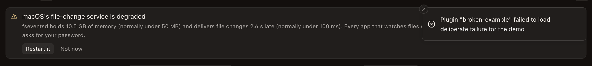
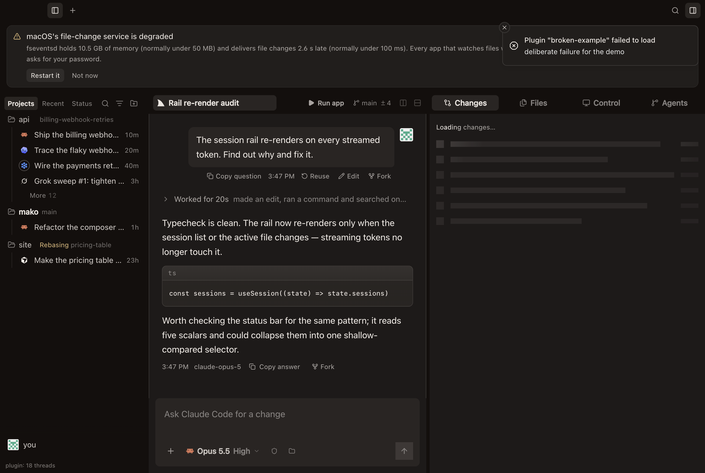
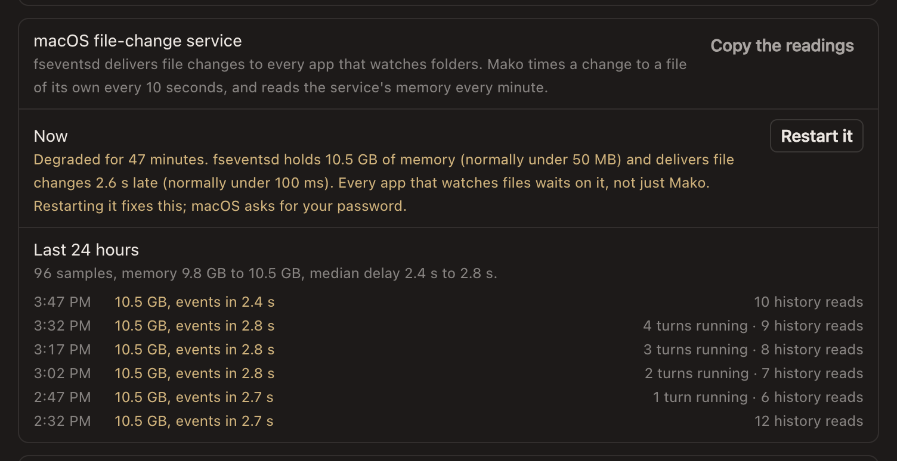
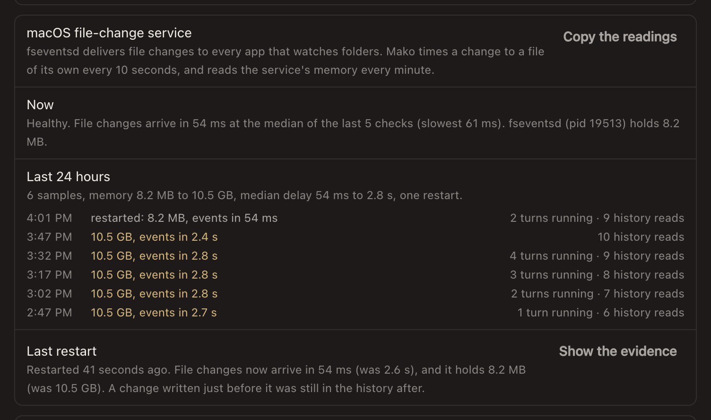
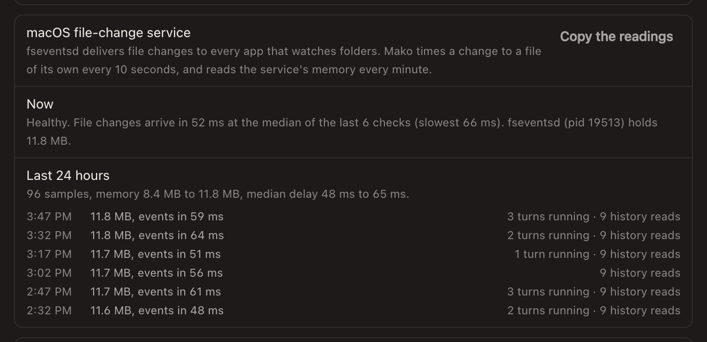
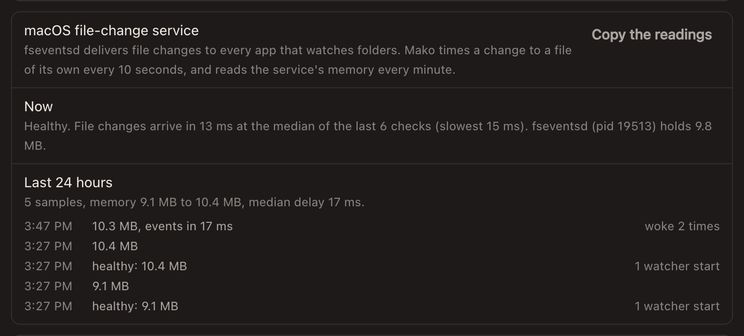

# fseventsd: degraded is said, and a restart fixes it

macOS's file-change service, `fseventsd`, delivers file events to every app that watches folders. After a month up on one Mac it held 24 GB (10.5 GB resident, the rest swapped out). Each new file took a median 2.6 s, and up to 4.2 s, to reach a fresh subscriber. `sudo killall fseventsd` fixed it. launchd started the daemon again, which then held 4 to 9 MB, delivered in a median 11.5 ms, and stayed there for 12 hours through three times the traffic.

Mako measured the lag already, through its watcher child's canary, but only worked around it. Its 5 s threshold for slow delivery never flagged 2.6 s, and its comments called batched delivery on a Mac a month up normal. With this change, Mako says when the daemon is degraded, gives the numbers, and offers the restart.

## Thresholds

| Reading | Healthy, measured here | Degraded when | Why |
|---|---|---|---|
| Canary beat lag, median of the last 6 (at least 4) | 13 to 17 ms on the host; 57 ms from a fresh probe | over 250 ms | 4 to 15 times healthy, and a tenth of the 2.6 s seen. A median over a minute of beats ignores one slow moment. |
| Canary unheard | heard every 10 s | 30 s unheard, twice | The watcher already calls this a silence. |
| Resident memory (`ps -o rss=`, no root) | 8 to 12 MB | over 1 GB, twice a minute apart | 20 times the 50 MB a healthy daemon stays under. The degraded one was at 10.5 GB. |

At the canary's 10 s beat, a lag past 250 ms is said after four beats, about 40 s. Memory is said within two minutes. The 5 s `SLOW_DELIVERY_MS` is unchanged: it decides when watches start polling around a slow daemon, not when Mako says the daemon is unwell.

## On the desk

A degraded fseventsd, from the mock bridge's `?app=fseventsd` scene, with the numbers measured on the degraded Mac:

Restart it, through the macOS password dialog. The evidence is captured in the same privileged step, then delivery is measured again:

A healthy Mac shows no notice. Diagnostics reads tens of milliseconds, here from the mock's healthy scene and from this Thread's own fixture desk, whose host measured this Mac's fseventsd:

`node scripts/file-events-screenshots.mjs <out>` draws the mock scenes and checks each one.

## Not run here

The restart path was tested only with a stand-in for the privileged step. Nothing here ran `killall fseventsd` or an administrator prompt. The first real restart records whether a change written just before it was still in the history afterwards (`historyKept` in its `summary.json`). Until that's known, Mako reports a read across a restart as lost.
