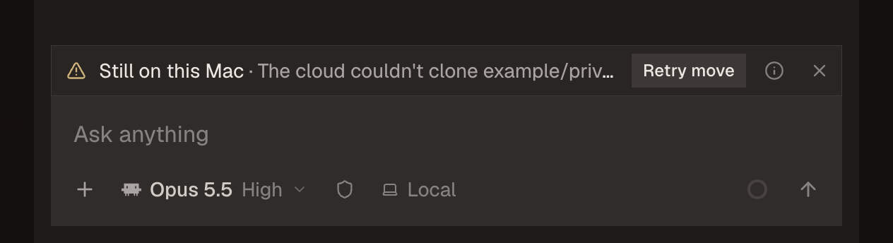
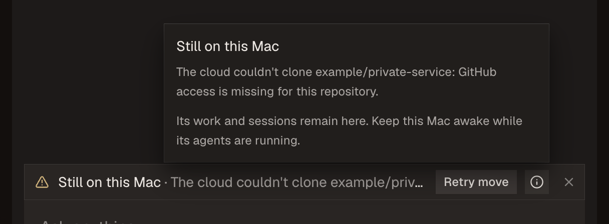
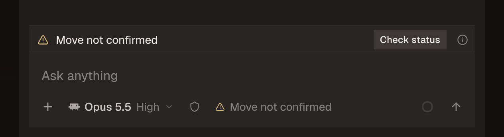

# Recovering a failed move to the cloud

This repair keeps a confirmed failed move visible above the desktop composer,
with the owner's reason, its local location, and explicit Retry and Dismiss
actions. A transport error instead says the move is unconfirmed. Its status
check uses the original move ID; it does not create a second move. A deliberate
retry after a confirmed refusal gets a new ID and retains handoff intent.

This is a first repair to the desktop recovery journey, not acceptance of the
cloud service as usable end to end. It changes renderer state and components,
plus the existing credential-free move UI test. It changes no host move,
authentication, repository-authority, provisioning, broker, or backend contract.

## Failure and cause

The source baseline is main `40b88bca2fd6629b144a16bcb89fbb944e795a12`.
`threadMoveStepped` removed the move from renderer state on `kept-here`,
leaving its reason only in a temporary toast. The existing UI test explicitly
expected the composer notice to disappear. An early RPC refusal without a
corresponding event was also ignored, leaving the initial packing state.
Exceptions were classified as `kept-here`, although losing a reply cannot
establish which machine owns the Thread.

That combination is a major recovery defect: after preparation fails, the
person loses the reason and next action; after a lost answer, the UI can imply
that the Thread stayed local without evidence. The reported five failed real
handoffs motivated this investigation, but were not repeated here. Their
private secondary-repository clone failure and exact authorization cause
remain the backend workstream's responsibility.

The repair keeps confirmed failures separately from active moves, so their
location chip returns to Local. They survive component updates and theme
changes until dismissed or a new move starts. They are held in this window's
memory, not durable across an app restart. Full error text and the instruction
to keep the Mac awake remain available from the notice's detail button.

An unconfirmed move keeps the original operation and disables starting a
different move from its chip. The chip stops spinning and says “Move not
confirmed.” Check status rejoins the original request. Only the owner's
`moved` event or authoritative `moved` RPC answer changes the location to Cloud; acceptance, release,
packing, and hand-over remain preparation or unresolved ownership states.

## Recovery after independent review

Review of `881851110d56988d2a6535826ad7845a618c98b1` found three gaps in
the first repair. Replaying the reviewer's unchanged controls reproduced all
three: a late refusal for A erased a pending explicit retry B and permitted C;
a same-ID status answer of `moved` left the UI unsettled; and a lost RPC answer
after an own-branch fork left the fork without its status action. The original
late-RPC identity control passed. The initial screenshots and source CI evidence
remain evidence of that revision, not proof that these gaps were covered.

The correction retains each observed move's original RPC conversation and
current event target, including its terminal identity after dismissal. Events
must match the move still held at that target before they can retarget, update
progress, settle, or refresh its location. A first host-originated move can
still be adopted in another window, without replacing an unresolved move.
A fork checks the same original operation from its current tab. Transport
loss and returned refusal update that tab. A stored, started host plan can
answer `moved` without replaying its event; that answer now settles and refreshes
the known target once, using the contract's optional fork conversation when
present. A complete moved event still refreshes the conversations it lists.
No readiness is inferred from `released`.

The existing UI suite now first executes the complete production cloud-moves
and store modules with deferred bridge replies and observable location effects.
Its controls assert event ownership across retries, same-ID terminal status,
forked loss/refusal, dismissal, stale RPC replies, first host adoption, target
collisions, disposed state, and an active check retargeting. These are offline
state controls; the bridge, toasts and location adapters are synthetic. They
do not exercise a real host or cloud service. The in-window identity history
and failure notices remain lost on reload or restart.

With the final assertions unchanged, the first repair failed seven of eleven
controls; the correction passed all eleven. The full existing move UI suite,
recipe typecheck and lint also passed. The UI run retained the existing
ResizeObserver warning. These local results do not replace review or source
CI of the correction.

The next private review, of `92b966b3c92486ad59bbb1a11ea8d2d1af41fc07`,
found a completion-order regression. A moved RPC answer settled the target;
the fence then rejected the same operation's later full moved event, leaving
other sessions unreconciled. The unchanged reviewer control reproduced this
only for RPC-first delivery; event-first delivery refreshed both sessions.

Completion now retains its member list and separately tracks location updates
and readbacks already applied. A matching successful operation can enrich its
membership while it remains the latest owner of its origin and target. New
operations, wrong targets, refused/dismissed identities and stale replies remain
fenced. The host's full event names actual moved sessions. An RPC-only result
instead reads back other live conversations whose host-derived Thread ID matches
the target; it does not synthesize their moved membership or location. A later
full event sets any missing member locations without repeating readbacks.
Richer completion metadata updates the existing toast ID. Repeated or partial
completion does not erase metadata or repeat location/readback effects.

The original eleven state controls remain. Seven added controls cover delivery
order, repetition, partial/full membership, wrong ID/target, a newer operation
at the target or sibling, RPC-only known-member readbacks and fork membership.
The identical final assertions fail four controls on the private second revision
and pass all eighteen on this correction. These remain isolated state evidence,
not runtime cloud or installed-app proof.

Operation identity, completion metadata and effect history are retained for the
window store's lifetime, with no finite count or TTL cap. Ownership lookup scans
that history; it is released with the store on reload or window disposal.
Blindly evicting old IDs would let delayed events be adopted as new operations,
reopening the stale-event failure. This repair does not add history eviction or
durable restart recovery.

A further private review of `fda22ecdc17185df2e4f0f9046e0c287d86771dc`
found that completion ownership covered only outbound moves. The unchanged
reviewer fixture reproduced a late outbound completion setting a sibling back
to Cloud after a confirmed return had made both sessions local.

The same operation history now covers both directions. Only an authoritative
`back` return event or RPC reply establishes local ownership. Its origin,
target and affected participants fence prior outbound completion effects;
later outbound ownership also fences that return's old replies and events.
Partial/full return membership converges with separately deduplicated location
and readback effects. Return events must match their operation ID and address;
conflicting unseen IDs at occupied addresses are remembered without authority,
so they cannot become new operations on replay. A return that stays or remains
unsettled establishes no local membership. Transport loss remains uncertain
and the status action keeps the same return ID.

The host return event names its actual plan sessions. Its RPC `back` outcome
has no member list, so it confirms the known target and reads back other known
Thread members without inventing local membership. If a host joins an existing
return under another ID, that event cannot replace the pending window request;
the actual RPC outcome and readbacks can still settle that request. No new
host flag or contract is introduced.

The original eighteen state controls remain green. Eleven added controls cover
confirmed return ordering, partial participants, sibling/fork addresses, stale
return replies, mismatched IDs/addresses, uncertainty and subsequent outbound
moves. With final assertions unchanged, the third private revision fails these
eleven controls and the correction passes all twenty-nine. The fixture now also
applies the real conversation update callback, so it records actual local/cloud
state changes as well as calls and effects. This remains offline evidence.
Both directions and ignored conflicting IDs share the same window-lifetime
history with no count/TTL cap; no restart durability is added.

Private review of `8cb2f9f6de251d0be0c4e4921b6c4f6e114dc69a` found a
liveness gap: a pending return correctly lost location authority to a newer
cross-member outbound completion, but its packing display and busy lock stayed.
The unchanged reviewer control reproduced the blocked subsequent action.

Confirmed completion now also retires older pending operations whose origin or
target it owns. Cleanup matches display/lock entries by operation ID, preserves
the retired identity as superseded, and establishes no location or return result.
It leaves newer and unrelated returns intact. A stale return completion also
retires only its own pending state. Late replies/events cannot restore that work.
There is no automatic retry or transfer.

The same final assertions fail six added controls on the fourth revision and
pass all thirty-five on this correction, with the original twenty-nine unchanged
and green. They cover success/loss replies, newer and unrelated return owners,
membership learned later, retained current locations and the unblocked explicit
next action. These remain isolated module/store controls; no extra GUI or real
cloud execution was performed.

## The first journey and its remaining gates

| Journey point | Evidence in this repair | Remaining acceptance |
| --- | --- | --- |
| Choose Cloud and prerequisites | Existing Local-chip offer and harness checks run in the fixture suite. | Real account eligibility, all repository permissions, and destination prerequisites must be established by their owners. |
| Provision and prepare code | A returned refusal without an event retains its actual reason and offers recovery. | Private multi-repository cloning, the serving image, readiness, and retained authorization diagnostics need real backend acceptance. |
| Carry the session and running turn | Retry preserves handoff intent, including repeated refusal events. Existing preparation, pause, hand-over, resume and moved UI cases still run. | An actual destination must claim ownership and continue the same work; an accepted command or `released` response is insufficient. |
| Use tools and apps there | No new capability claim. | Tools, app ports, previews and repository/worktree contents need verification on that same destination. |
| Disconnect or close the lid | Lost replies stay unconfirmed and can be checked under the same ID; no shutdown clearance is given. | Actual continuation through disconnect/sleep and recovery remains untested. |
| Return and recover | Existing fixture return, version mismatch, missing project, unsettled return and merge cases remain in the suite. | Real return must preserve work and ownership, including restart recovery. |
| Cleanup and cost | Dismiss removes only the local failure notice; it neither starts nor cancels a cloud operation. | Actual machine cleanup and cost visibility are not proved by a local refusal and require separate runtime evidence. |

The backend authority/coordinator/security workstream, move diagnostics work,
and crew-card work are not modified by this branch. No permission is inferred
from a message saying that a move was accepted.

## What the comparison sources actually say

Capy's current documentation separates choosing the machine and checkout from
moving existing work. Its cloud move requires GitHub App access to every
repository and available credits; the project environment is prepared before
restoring work. It also names what does not move, including running dev
servers. Those are useful prerequisite and expectation boundaries, not proof
that Mako already has them. [Capy desktop and devices](https://docs.capy.ai/desktop).

T3 Code's remote-access guide requires the execution host to remain running
and reachable; a saved sign-in alone does not make it available. Its remote
architecture keeps execution and durable state with the environment, while
connection routes are separate. A reachable route or a saved connection is
therefore a different fact from where a Thread executes. These are current
documentation comparisons, not measured runtime parity.
[T3 remote access](https://github.com/pingdotgg/t3code/blob/main/docs/user/remote-access.md),
[T3 remote architecture](https://github.com/pingdotgg/t3code/blob/main/docs/internals/remote.md).

## Review evidence

The screenshots use fake projects, repositories and sessions from the existing
isolated mock bridge. No actual cloud machine, provider, account sign-in,
grant, token, keychain, native session store, paid compute, install, or release
was used. The test drives the production components with trusted input; it
does not prove any real remote continuation.

Before, the refusal has no standing composer notice once its toast goes:


After, a confirmed refusal retains its reason and explicit retry:



The detail keeps the full reason and the local-work guidance:



A lost reply is distinguished from a confirmed refusal:



The extended `test:moves-ui` cases check that a failure remains after the toast
ends; it does not retry automatically; an explicit retry has a new ID; an
early returned private-repository refusal is retained without an event;
dismiss does not make another call; a lost reply is not a local refusal;
Check status keeps its ID; the unconfirmed chip is disabled and does not spin;
and a refused handoff retains its intent after a repeated event and retry.
The rest of the existing move/return suite runs too, in dark and light themes.

Completed locally: package compilation, recipe typecheck and full lint, final
scoped typecheck/ESLint/Oxlint, and the full extended move UI suite. Baseline
and reviewed-run screenshot/state artifacts are included beside this report.
CI for the new PR is a separate result; these checks do not establish installed
or live-cloud success.

Reproduce on a free allocated Thread port:

```sh
MAKO_TEST_EVIDENCE=<private-evidence-folder> npm run test:moves-ui -- --port <port>
```

Build the checkout's packages with `npm run build:control-runtime` first when
their generated output is missing or old. Recipe typecheck and lint cover the
source changes. There is no dependency, recipe, application-entry, or server
start command change.

The baseline suite logged an existing ResizeObserver delivery warning; it is
retained as a limitation rather than reported as a clean console. One new
handoff test initially clicked during a moving composer layout and sent no
retry request, as its call trace showed. It now waits for the fixture's
existing finite animations before clicking. That observation correction does
not stand in for backend readiness or actual shutdown testing.
